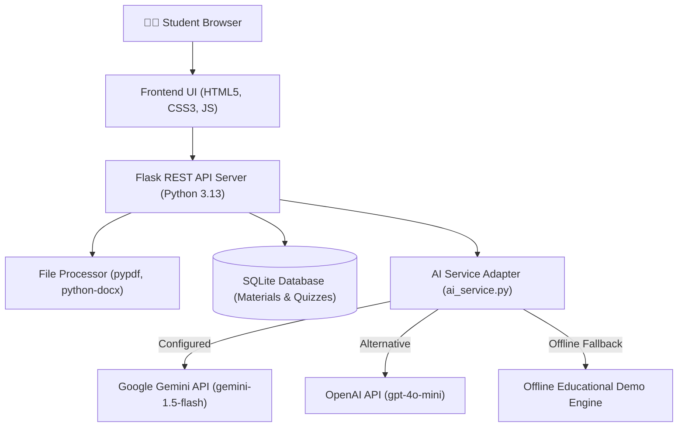

# 🏆 Hackathon Presentation & Pitch Document

## Project Title
**AI Study Assistant — Your Personal AI Learning Partner**

---

## 1. Problem Statement
Every exam season, students face an overwhelming mountain of unstructured study materials: 80-page presentation slide decks, dense textbook chapters, and handwritten or digitized lecture notes. 
Students spend over **70% of their revision time manually reading and formatting notes**, leaving less than 30% for actual cognitive practice and active recall. Furthermore, non-native English speakers frequently struggle with complex academic concepts due to the absence of clear vernacular explanations.

---

## 2. Proposed Solution
**AI Study Assistant** is a modern, student-centric web application that acts as an intelligent personal tutor. It ingests study notes (via text, PDF, or Word documents) and transforms them into:
1. **Concise, High-Yield Summaries** with definitions, formulas, and bulleted takeaways.
2. **Bilingual Step-by-Step Concept Breakdowns** in English or Telugu (తెలుగు).
3. **Practice Questions** (MCQs with immediate feedback, short-answers with model answers, and long essays with outlines).
4. **Interactive 3D Flashcards** for active recall revision.
5. **Timed Mock Examinations** with real countdown pacing, instant grading, and rationales.
6. **Local Saved Study Library** powered by SQLite with zero subscription lock-in.

---

## 3. Target Users
- **Undergraduate & High School Students**: Preparing for midterms, finals, and competitive entrance exams.
- **Vernacular-medium Learners**: Engineering and science students who benefit from technical explanations in their mother tongue (Telugu).
- **Self-Directed Learners & Bootcampers**: Needing instant active-recall testing from documentation and tutorials.

---

## 4. System Architecture

---

## 5. Technology Stack
- **Frontend**: HTML5, Vanilla JavaScript (ES6+), CSS3 Design System with Light/Dark Theme, 3D CSS Card Flip.
- **Backend**: Python 3.13, Flask 3.1, Blueprints, Werkzeug file security.
- **Database**: SQLite 3 embedded database.
- **Document Ingestion**: `pypdf`, `python-docx`.
- **AI Engine**: Google Gemini API, OpenAI API, and Offline Demo fallback.
- **Testing**: `pytest` (21 automated unit and integration tests).

---

## 6. Innovation and Uniqueness
1. **Bilingual Regional Inclusion**: First-class support for conceptual explanations in **Telugu (తెలుగు)**, breaking language barriers in technical STEM subjects.
2. **Anti-Hallucination & Anti-Prompt-Injection Prompting**: System instructions explicitly bound user notes as untrusted content, preventing prompt injection and enforcing grounding strictly in supplied notes.
3. **True Active Recall Over Passive Reading**: Rather than simply spitting out walls of text, it creates 3D flashcards with "Known/Review" metrics and a real timed mock exam with automated grading.
4. **Graceful Offline Resilience**: If no API key is provided, the application does not break or show cryptic errors; it cleanly activates an interactive demo mode with clear transparency banners.

---

## 7. Social Impact
- Democratizes access to high-quality private tutoring for students from low-income or regional language backgrounds.
- Reduces academic stress and cramming fatigue by promoting proven cognitive study techniques (active recall & spaced testing).
- Keeps data private and free from predatory subscription models through embedded local storage.

---

## 8. Limitations & Honest Engineering Trade-Offs
- **Scanned Image PDFs**: Does not perform OCR on handwritten paper photos without external Tesseract or Vision models (the app explicitly detects this and advises the student).
- **Single-Device Storage**: The initial version uses SQLite locally on the user's computer, meaning saved materials are not yet synchronized across multiple devices without cloud authentication.

---

## 9. Future Scope
- Add Tesseract OCR for camera snapshots of handwritten lecture notebooks.
- Introduce spaced repetition scheduling based on the Leitner box algorithm.
- Multi-user authentication with PostgreSQL and encrypted cloud synchronization.
- Voice-enabled audio explanations in Telugu and English.

---

## 🎤 10. Two-Minute Pitch Script

> *"Good morning/afternoon, judges and fellow students!*
>
> *Raise your hand if you've ever found yourself at 2:00 AM before a major exam, staring blankly at an 80-page slide deck, wondering: 'How am I supposed to memorize all of this in six hours?'*
>
> *Every student faces this challenge. We spend hours re-reading dense textbooks, manually copying definitions, and struggling to predict what questions will actually appear on the test. For vernacular-medium students studying technical engineering in English, this barrier is twice as difficult.*
>
> *That’s why we built **AI Study Assistant — Your Personal AI Learning Partner**.*
>
> *AI Study Assistant is a modern web application designed from the ground up for real academic revision. You simply upload your lecture PDF or paste your study notes, and within seconds, our AI converts them into:*
> 1. *A structured summary with key definitions, formulas, and bulleted takeaways.*
> 2. *Step-by-step concept explanations with real-world analogies in English—or in **Telugu** for bilingual students.*
> 3. *Practice questions—ranging from MCQs to essay outlines with examiner rubrics.*
> 4. *An interactive 3D flashcard deck for active recall.*
> 5. *And a timed mock exam that simulates real test pressure, grades your answers automatically, and explains why each option is correct or incorrect.*
>
> *Best of all, it stores everything in an embedded SQLite database with zero subscription friction, zero cloud lock-in, and full privacy.*
>
> *Let us show you how it works in real time!"*

---

## ⏱️ 11. Three-Minute Live Demonstration Plan

| Time | Action | Demonstration Details |
| :---: | :--- | :--- |
| **0:00 - 0:30** | **Landing & Dashboard** | Show the clean UI, toggle between Dark and Light mode, and highlight real SQLite metrics on the dashboard. |
| **0:30 - 1:00** | **Notes Ingestion** | Click **Study Workspace**. Click **"Load Sample CSE Notes"** (or upload a PDF/DOCX) to show instant word/character counting and editable preview. |
| **1:00 - 1:30** | **Notes Summarizer & Telugu Explainer** | Generate a Medium summary. Switch to Concept Explainer, type *"Binary Search"*, select **Telugu**, and show the step-by-step breakdown in Telugu script with self-check questions! |
| **1:30 - 2:15** | **Flashcards & Mock Exam** | Open Flashcards: flip the 3D card using Spacebar, show "Mark Known" and "Shuffle". Switch to Mock Exam: start a 5-question timed quiz, click answers, show live countdown, submit, and display automated score and rationale breakdown! |
| **2:15 - 3:00** | **Saved Library & Q&A** | Navigate to **Saved Materials**: demonstrate searching and viewing saved materials in the modal, and open the floor for judge questions. |

---

## ❓ 12. Likely Judge Questions & Honest Answers

### Q1: *"How do you prevent the AI from hallucinating incorrect facts on academic topics?"*
**Answer**: *"We address this at the prompt engineering and architectural level. We treat user notes as untrusted context delimited within `<<<STUDY_NOTES_START>>>`. We explicitly instruct the model to ground summaries and questions strictly in the provided text and set the model temperature to a conservative 0.3. For practice questions, we force structured JSON output that requires an explicit pedagogical explanation for why the chosen option is correct."*

### Q2: *"What happens if a student uploads a scanned textbook PDF that has no selectable text?"*
**Answer**: *"Our `file_processor` uses `pypdf` to measure extracted character count across pages. If a multi-page document yields fewer than 30 characters, the app immediately identifies it as a scanned image and displays an actionable warning informing the student that OCR is required, rather than failing silently with an empty summary."*

### Q3: *"Why did you choose Flask and SQLite instead of a heavy React/Node/PostgreSQL stack?"*
**Answer**: *"For real student adoption and hackathon reliability, simplicity and zero maintenance matter. A first-year CSE student can clone this repository, run `pip install -r requirements.txt`, and launch it with `python app.py` on any Windows, Mac, or Linux laptop in under two minutes without setting up Docker, npm, or database services. The modular Blueprints and service classes make it trivial to swap SQLite for PostgreSQL or attach React later if desired."*

### Q4: *"Can this run without paying for expensive AI API keys?"*
**Answer**: *"Yes! Google Gemini provides a generous free tier via AI Studio. Furthermore, we designed an intelligent Offline Demo Mode that gracefully serves structured sample responses if no API key is supplied, clearly indicating this via a UI banner so judges and students can test the entire workflow without paying a penny."*
